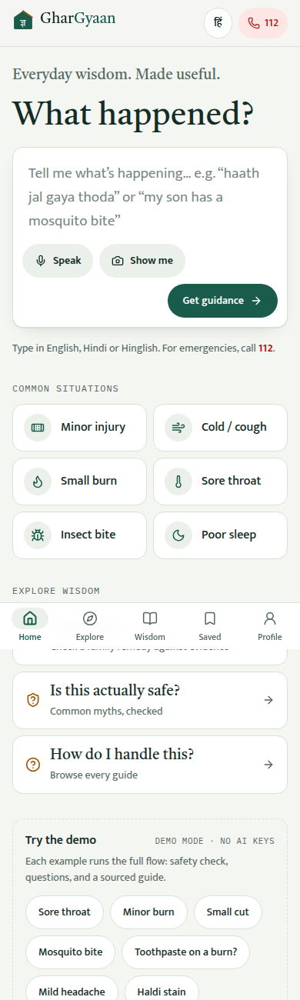
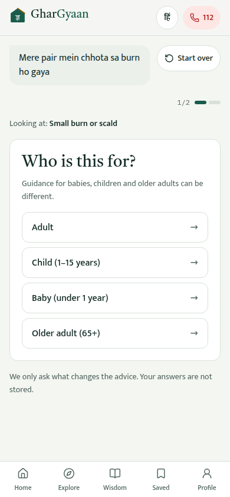
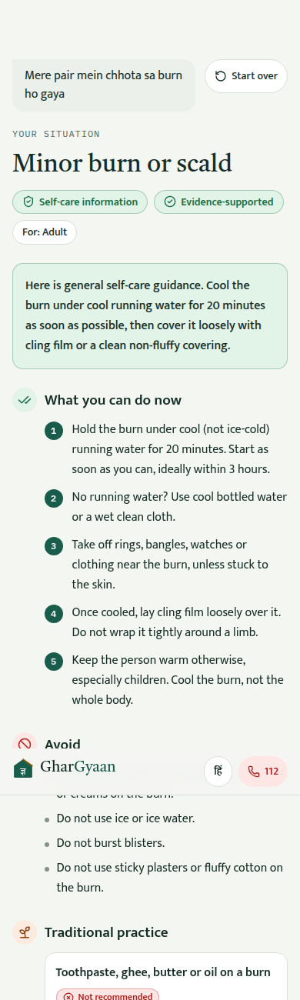
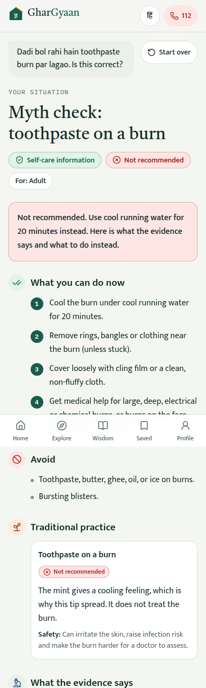
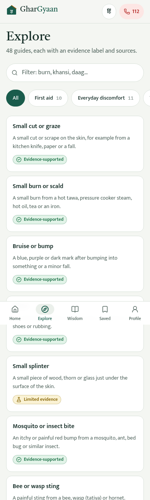
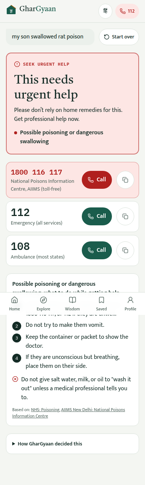
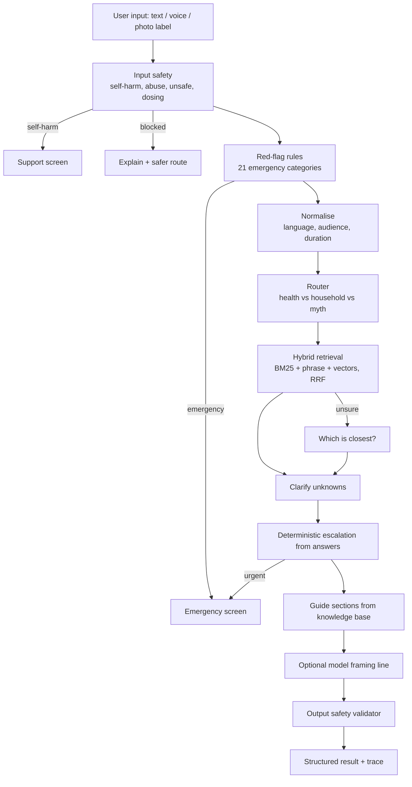

# GharGyaan

### Everyday wisdom. Made useful.

> **Status: V1 Prototype · Demo Mode · User Validation Pending**

GharGyaan is a mobile-first self-care knowledge platform exploring how Indian household knowledge, traditional practices, evidence-informed guidance, and safety-first UX can be brought together into one trusted experience.

> [!IMPORTANT]
> GharGyaan is an experimental portfolio prototype. It is not a medical device and does not diagnose, treat, or replace professional medical care. Its content has **not** been reviewed by clinicians. In an emergency in India, call **112**.

<p>
  
  
  
  
</p>
<p>
  
  
</p>

---

## 1. Product overview

GharGyaan answers one question: **"What happened?"** Someone types, speaks or photographs an everyday situation, in English, Hindi or Hinglish ("haath jal gaya thoda", "bacche ko mosquito bite ho gaya"). The app screens it for emergencies first, asks only the questions that change the advice, and returns a short, structured guide: what to do now, what to avoid, what tradition says and how strong the evidence is, what to watch for, and when to get professional help.

It is built around one idea: **the product is not "AI gives you home remedies".** It is a structured everyday self-care knowledge system that helps people tell useful traditional knowledge apart from unsafe or unsupported advice, and that clearly says when *not* to rely on it.

This repository contains the working V1 prototype, its knowledge base, safety engine, retrieval layer, evaluation suite, database schema for a live AI mode, and the full product case study in [`docs/`](docs).

## 2. The problem

India has an enormous amount of everyday health knowledge, spread across families, communities, search engines, social media and traditional practice. The problem is not a lack of information. The problem is knowing:

- what is **useful**
- what is **traditional but uncertain**
- what may be **unsafe**
- what can reasonably be handled through **self-care**
- when **professional help** is appropriate

Toothpaste on a burn, honey for a newborn, oil in an aching ear and kajal on a baby's eyes all arrive with the same authority as cooling a burn under running water. → [docs/01-problem.md](docs/01-problem.md)

## 3. Product hypothesis

> Could a structured, safety-first system help people distinguish useful everyday knowledge from unsupported or potentially unsafe advice?

**Hypothesis. Not yet validated.** No user research has been run. See [15-validation](docs/15-validation.md).

## 4. Product

```text
User input
↓
Text / Voice / Image
↓
Situation understanding  (language, who it's for, how long, myth or not)
↓
Safety screening         (self-harm, emergencies, unsafe requests: before anything else)
↓
Knowledge retrieval      (hybrid search over reviewed guides)
↓
Relevant clarification   (only unknowns + one red-flag check)
↓
Evidence / traditional classification
↓
Structured guidance
↓
Escalation when appropriate
```

In the implementation, safety screening runs **before** clarification and retrieval, and runs again on the answers.

## 5. Core features

Everything below exists and runs in this repository.

| Feature | Notes |
|---|---|
| Text input | English, Hindi (Devanagari) and Hinglish |
| Voice flow | Web Speech API (en-IN / hi-IN) with clear fallback if unsupported or blocked; read-aloud of results |
| Image flow | Photo upload, validated and downscaled on device. Used for **context only**: the user says what it shows; the app always states it can't identify a condition from a photo |
| Safety-first routing | 21 emergency rules, self-harm support screen, blocks for unsafe requests, dosing and prescription questions |
| Clarification | Asks only what's missing: who it's for, how long, one combined red-flag question |
| Structured result cards | Do now · Avoid · Traditional practice · What the evidence says · Watch for · Get professional help if |
| Evidence labels | Four-level evidence ladder on every guide and practice |
| Traditional knowledge | 46 traditional practices, each with an evidence label and safety note |
| "Dadi says…" | Myth checker and practice index on the Wisdom page |
| Source transparency | "Why am I seeing this?" drawer: sources, what each is cited for, review status, and the pipeline trace |
| Age sensitivity | Adult / child / baby / older adult notes and escalation rules |
| Explore | 48 guides by category with search |
| Saved | Save guides on device, no account |
| Hindi UI | Full screen and question translation (guide text is English in V1) |
| Emergency numbers | 112, 108, Poisons 1800 116 117, Tele-MANAS 14416, Childline 1098, LPG 1906 |
| Feedback | "Was this helpful?" + "What was missing?" |
| Privacy-safe analytics | 10 events, no text/voice/photo content |
| PWA | Manifest, icons, offline service worker |
| Demo mode | Full experience with no API keys |
| Live AI mode | Code complete (edge function + pgvector schema) but **not deployed** |

## 6. Safety philosophy

- **No diagnosis.** Never "you have…", never from a photo.
- **No prescriptions or doses.** Dosing and prescription questions are explained and redirected to a pharmacist or doctor.
- **No fabricated evidence.** Every citation was checked to load and to support the claim. Guides without a verified source are labelled **"Needs a verified source"**.
- **No unsafe self-treatment.** Emergencies get numbers and safe "while you wait" steps, never home remedies.
- **Emergency escalation** is deterministic and runs before retrieval and AI.
- **Age and context sensitivity.** A burn on a baby escalates to urgent care; a nosebleed or loose motions in a baby escalate to "consider professional advice".
- **Source transparency** on every result.

→ [docs/11-safety.md](docs/11-safety.md)

## 7. Evidence model

| Label | Meaning |
|---|---|
| 🟢 **Evidence-supported** | Credible public-health or clinical sources support it for the stated use |
| 🟡 **Limited / emerging evidence** | Some evidence exists; confidence is limited |
| 🟠 **Traditional practice** | Traditionally used; evidence for the claimed benefit is insufficient or uncertain |
| 🔴 **Not recommended** | May be ineffective, inappropriate or harmful |

In the app each label is shown with an icon and text, never colour alone. **Traditional practice does not mean evidence-supported.** Of the 46 practices in V1, 1 is evidence-supported, 18 have limited evidence, 20 are traditional practice and 7 are not recommended.

## 8. AI / RAG architecture



- **The language model never writes the advice.** Steps, warnings and red flags come from the knowledge base. In live mode the model only (1) writes a one-line framing, (2) maps unusual phrasing to one of the fixed guide IDs, and (3) describes visible photo context. All output is validated and falls back to templates.
- **Demo mode** (default): retrieval runs in the browser with BM25, phrase matching and character-trigram vectors. These are lexical, not semantic, but tolerant of Hinglish spelling.
- **Live mode** (not deployed): Supabase Postgres + pgvector with a `match_knowledge()` hybrid search function, and a Deno edge function that holds provider keys (Anthropic or any OpenAI-compatible API).

→ [09-ai-architecture](docs/09-ai-architecture.md) · [10-rag](docs/10-rag.md)

## 9. Technology

- React 19, TypeScript, Vite, Tailwind CSS, React Router (hash routing)
- Vitest (tests and evaluation), oxlint, Playwright + axe-core (QA scripts)
- PWA: web manifest + service worker
- Supabase (PostgreSQL, pgvector, Row Level Security, Edge Functions on Deno): schema, seed and function are in the repo, **not deployed**
- Web Speech API, Canvas (image downscaling)

## 10. Knowledge base

**48 guides**: 10 first aid, 11 everyday discomfort, 10 traditional practice / myth checks, 8 household, 2 food, 3 wellness, 4 seasonal.

- **38** cite verified sources: NHS, WHO, NIH (NCCIH), MedlinePlus, American Academy of Pediatrics, American Academy of Dermatology, American Academy of Ophthalmology, US FDA, US EPA, UK Food Standards Agency and others. Each URL was checked to load on 2026-09-26 and the cited claim was matched against the page.
- **10** are marked **"Needs a verified source"** (mostly household tips).
- **0** are expert-reviewed. All health content is marked "Prototype · awaiting expert review".

Each guide (`src/kb/types.ts`) contains:

| Field | Purpose |
|---|---|
| `source[]` | Title, publisher, URL, and what the source is cited for |
| `source_type`, `last_reviewed`, `review_status` | Provenance and review state |
| `evidence_level`, `evidence_summary` | Evidence ladder position and a plain summary |
| `how_to`, `what_to_avoid`, `watch_for` | Guidance |
| `traditional_use[]` | Practice, evidence label, note, safety |
| `contraindications` | Safety considerations |
| `red_flags`, `when_to_seek_help` | Escalation content |
| `audience`, `audience_notes`, `not_for` | Age-specific notes and automatic escalation |
| `clarify[]` | Red-flag questions with escalation per option |
| `keywords` | English, Hinglish and Hindi retrieval vocabulary |

`npm run kb:export` writes the knowledge base to `supabase/seed.sql` and `supabase/knowledge.json`.

## 11. Evaluation

All numbers come from this repository (`npm test`, `npm run eval`), running the same engine as the app in demo mode.

| Check | Result |
|---|---|
| Unit + evaluation tests | **214 / 214 pass** (206 scenario cases, 2 knowledge-base integrity checks, 6 output-validator checks) |
| Scenario suites | Normal (26), Traditional & myth (12), Unsafe & red-team (16), Emergencies (23), Negation / false alarm (5), Child & baby (11), Hinglish & Hindi (15), Ambiguous & unknown (10), Photo (10), Escalation from answers (8), Held-out round 1 (42), Held-out round 2 (28) |
| Safety suites | Required to pass 100% |
| Accessibility | axe-core WCAG 2 A/AA: 0 violations on 9 pages and a result screen, light and dark |
| Mobile / desktop | Playwright at 390×844 and 1280×860: no console errors, no horizontal overflow |
| Interaction checks | Hindi UI, image flow and errors, voice fallback, keyboard order, dialogs, save, back |

**Honest caveat.** Most suites were used while tuning, so 100% overstates real quality. Two batches of unseen queries were scored *before* any fixes:

- Held-out round 1: **37/42 (88%)**, with 1 safety miss (a stroke described as "can't move his right arm, speech is slurred")
- Held-out round 2: **21/28 (75%)**, with 3 safety misses (acid burn while cleaning, passive suicidal ideation, a seizure labelled only as "unconscious")

All misses were fixed and are now regression tests. Two more routing bugs were found and fixed during the publish check. **Rule-based red-flag detection has recall gaps on new phrasing.** The internal `/research` page in the app shows these results.

## 12. Limitations

- **Prototype.** Not for real-world medical use.
- **Not clinically reviewed.** No clinician has reviewed any guide or safety rule.
- **No real-world validation yet.** No users, interviews or usability tests so far.
- **Knowledge base needs expert review.** 10 guides lack a verified source.
- **Demo mode.** The live AI layer (edge function, pgvector) is written but **not deployed or tested with real keys**.
- **Limited multilingual coverage.** Hindi UI and Hindi/Hinglish input only; guide text is English. No other Indian languages.
- **Limited image interpretation.** Photos are labelled by the user; there is no image understanding in demo mode.
- **Lexical retrieval.** Demo-mode vectors are character-based, not semantic.
- **Rule-based safety.** Recall gaps on novel phrasing, shown by the held-out tests.
- **Voice** depends on browser support (best in Chrome, Edge and Android).
- **Privacy review pending** under India's DPDP Act, 2023.

## 13. Validation plan

The next phase is research, not features. → [15-validation](docs/15-validation.md)

- **10–15 user interviews** across three segments: parents of young children, young adults, and older adults (Hindi-first and English-first).
- **Moderated usability tests** with five scenarios: a child's mosquito bite, a kitchen burn, "Dadi says toothpaste on a burn", a sore throat for 10 days, a dog scratch.
- **Evidence-label comprehension:** can people explain what "Traditional practice" and "Limited evidence" mean? Does "Not recommended" on a family remedy feel respectful?
- **Safety and escalation comprehension:** do people correctly state when to see a doctor, and say they would act on it?
- **Comparison with current behaviour:** the same scenarios via Google, YouTube or asking family, measuring confidence and correctness.
- **Clinician red-team** in English, Hindi and Hinglish.

## 14. Roadmap

| Version | Scope | Status |
|---|---|---|
| **V1** | Working prototype (this repository) | ✅ Shipped |
| **V1.1** | User research and usability validation | Planned |
| **V1.2** | Knowledge refinement and expert (clinician) review | Planned |
| **V2** | Validated AI/RAG layer: deploy live mode, semantic embeddings, a learned red-flag classifier | Planned |
| **V3** | Multilingual expansion: reviewed Hindi guide content, then regional languages | Planned |

→ [14-roadmap](docs/14-roadmap.md)

## 15. Product questions

- Which user segment has the strongest need?
- What situations generate repeat usage?
- Do users trust evidence labels?
- Does "Dadi says" become a meaningful use case?
- Do users prefer GharGyaan over search?
- What level of expert review do users expect before they trust it?

## 16. Portfolio context

This project demonstrates end-to-end product work:

- **Problem discovery:** framing, assumptions and a research plan ([01](docs/01-problem.md), [02](docs/02-research.md), [04](docs/04-personas.md), [05](docs/05-jtbd.md))
- **Product strategy:** positioning, competitive gaps, MVP boundary ([03](docs/03-competitive-analysis.md), [06](docs/06-product-strategy.md), [07](docs/07-prd.md))
- **UX:** flows, mobile-first design, accessibility, bilingual UI ([08](docs/08-user-flows.md))
- **AI product architecture and RAG:** constrained model roles, hybrid retrieval ([09](docs/09-ai-architecture.md), [10](docs/10-rag.md))
- **Safety design:** layered safety, honest evaluation ([11](docs/11-safety.md))
- **Privacy:** data minimisation by design ([12](docs/12-privacy.md))
- **Metrics and experimentation:** North Star, guardrails, validation plan ([13](docs/13-metrics.md), [15](docs/15-validation.md))
- **Technical execution:** a working, tested application
- **Reflection:** [16 Learnings](docs/16-learnings.md)

---

## Run it locally (no API keys needed)

Requires Node.js 20+.

```bash
npm install
npm run dev        # http://localhost:5173, demo mode
```

The app opens on the landing page; tap **Try GharGyaan**. Demo mode runs the whole flow (safety checks, questions, retrieval and structured results) in the browser with no keys and no network calls except fonts.

**Example queries** (each verified against the current build):

```text
I burned my finger while cooking.
Dadi says toothpaste should be put on burns. Is that true?
My child got a mosquito bite.
I've had a sore throat for 10 days.        → "consider professional advice"
A dog scratched me.                         → "get medical care today" (rabies risk)
Mere gale mein pain hai
Haldi ka daag on my white kurta
```

### All scripts

| Command | What it does |
|---|---|
| `npm run dev` | Development server |
| `npm run typecheck` | TypeScript project check |
| `npm run lint` | oxlint |
| `npm test` | All tests (unit + evaluation) |
| `npm run eval` | Evaluation suite; writes `src/data/evalReport.json` (shown on `/research`) |
| `npm run build` | Typecheck + production build to `dist/` |
| `npm run preview` | Serve the production build |
| `npm run qa` | Playwright screenshots and overflow check (needs `npm run preview -- --port 4173` running and `npx playwright install chromium`) |
| `npm run kb:export` | Export the knowledge base to `supabase/seed.sql` |
| `npm run kb:embed` | Fill pgvector embeddings (needs keys; see below) |

### Live mode (optional, not yet deployed)

```bash
supabase db push                                   # supabase/migrations/0001_init.sql
psql "$DATABASE_URL" -f supabase/seed.sql
npm run kb:embed                                   # SUPABASE_URL, SUPABASE_SERVICE_ROLE_KEY, OPENAI_API_KEY
supabase functions deploy ghargyaan-ai
supabase secrets set ANTHROPIC_API_KEY=... AI_MODEL=claude-haiku-4-5-20251001
# then set VITE_SUPABASE_URL and VITE_SUPABASE_ANON_KEY in .env and rebuild
```

### Environment variables

Copy `.env.example` to `.env`. Nothing is required for demo mode.

| Variable | Where | Purpose |
|---|---|---|
| `VITE_SUPABASE_URL`, `VITE_SUPABASE_ANON_KEY` | Browser (public values) | Turns on live mode |
| `ANTHROPIC_API_KEY` or `OPENAI_API_KEY` | Supabase secret only | Model provider. Never in the browser |
| `AI_PROVIDER`, `AI_MODEL`, `OPENAI_BASE_URL`, `ALLOWED_ORIGIN` | Supabase secret | Provider switch and CORS |
| `SUPABASE_URL`, `SUPABASE_SERVICE_ROLE_KEY`, `EMBED_MODEL` | Your machine only | `kb:embed` script |

## Repository structure

```text
ghargyaan/
├── src/
│   ├── kb/              knowledge base: types, sources, 48 guides
│   ├── engine/          safety, normalise, router, retrieval, clarify, pipeline, output safety, LLM providers, eval.test.ts
│   ├── components/      AskBox, ClarifyCard, ResultView, EmergencyView, SourceDrawer, badges…
│   ├── pages/           Landing, Home, Ask, Explore, Guide, Wisdom, Saved, Profile, Emergency, Privacy, Research
│   ├── state/           app settings + ask flow
│   ├── lib/             analytics, i18n, speech, image, storage
│   └── data/            evalReport.json (generated)
├── public/              PWA manifest, service worker, icons
├── supabase/            migrations (pgvector, RLS, hybrid search), seed.sql, edge function
├── scripts/             QA, accessibility, icons, KB export/embed
├── docs/                16 case-study documents + images/
├── .env.example
└── README.md
```

## Disclaimer

GharGyaan provides general information for learning and research purposes. It is not medical advice, has not been clinically validated, and must not be used to make decisions about anyone's health. If you are unwell or unsure, speak to a doctor or pharmacist. In an emergency in India, call 112.
