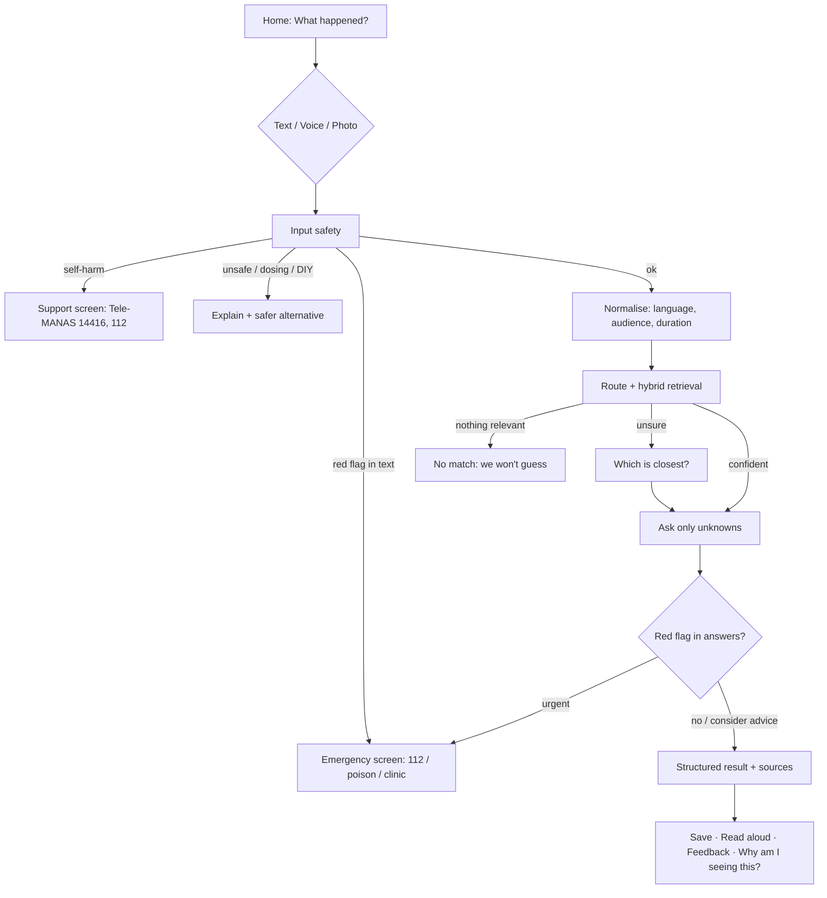

# 08 · User flows

## Core flow

## Photo flow
1. Tap **Show me** → pick or take a photo (validated: image type, ≤10 MB; downscaled on device).
2. App shows the photo disclaimer and asks **What does the photo show?** (burn, cut, bite, rash, bruise, blister, stain, mould).
3. The chosen label (plus any text) runs through the same pipeline. The result repeats the disclaimer.
4. Live mode only: a vision model may add a neutral description ("small red area on the back of a hand"), which is validated and never used as a diagnosis.

## Voice flow
Tap **Speak** → Web Speech API (en-IN or hi-IN by UI language) → transcript fills the box → user reviews and submits. If unsupported or blocked: a clear message and the text box keeps working. Results can be **read aloud** (speechSynthesis).

## Browse flows
- Explore → category → guide → "Check my situation" (runs the clarification flow for that guide).
- Wisdom → "Dadi says…" box → myth check; practice index filtered by evidence level.
